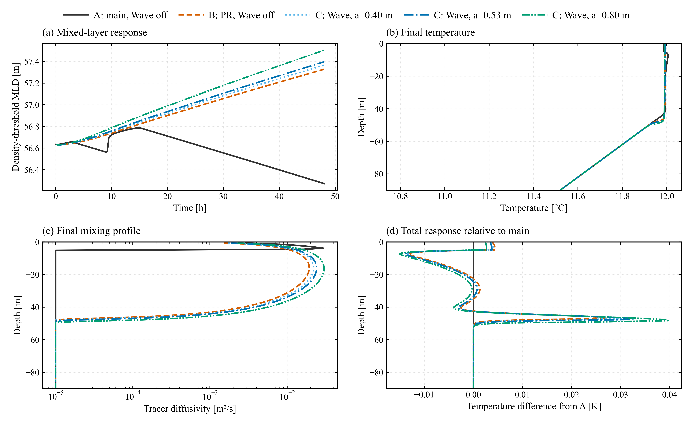
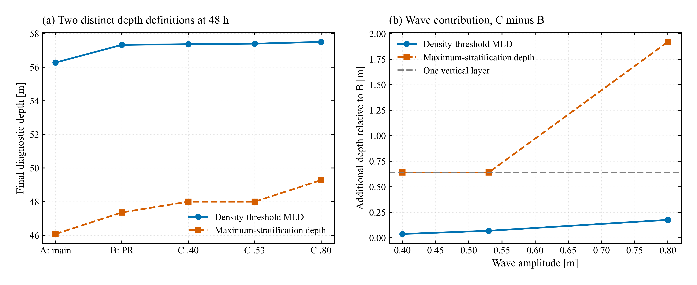
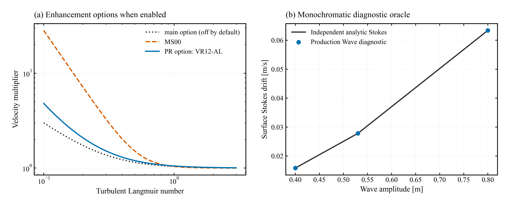

# Wave–KPP coupling against current main

This comparison was refreshed on 2026-11-24 using an unmodified upstream
main export and the PR implementation containing that same upstream version.
It evaluates a literature-based prescribed-wave column, separating the
shared KPP default change from the incremental Wave feedback.

## Model configurations

| Arm | Implementation | Actual buoyancy flux | Langmuir feedback |
|---|---|---|---|
| A | Unmodified main | Upstream default: off | Off |
| B | PR, Wave off | PR default: on | Off |
| C | PR, prescribed waves | On | VR12-AL at three amplitudes |

A retains upstream's adiabatic N², column unresolved-shear velocity scale,
partial-cell implementation and disabled gradient surrogates. B and C retain
those same settings. B enables the upstream actual-buoyancy-flux correction by
default; C additionally supplies Wave-derived surface Stokes magnitude to the
published aligned VR12 enhancement. The existing main enhancement option is
still present in main, disabled by default; its formula is shown as an option,
not as active physics in arm A.

## References and protocol

- Van Roekel et al. (2012), *The form and orientation of Langmuir cells for
  misaligned winds and waves*, [doi:10.1029/2011JC007516](https://doi.org/10.1029/2011JC007516).
- Li et al. (2016), *Langmuir mixing effects on global climate: WAVEWATCH III
  in CESM*, Table 2 / Eq. (12), aligned VR12-AL:
  [doi:10.1016/j.ocemod.2015.07.020](https://doi.org/10.1016/j.ocemod.2015.07.020).
- Li & Fox-Kemper (2017), *Assessing the Effects of Langmuir Turbulence on
  the Entrainment Buoyancy Flux in the Ocean Surface Boundary Layer*,
  Table 1 S-L2 / Eq. (4):
  [doi:10.1175/JPO-D-17-0085.1](https://doi.org/10.1175/JPO-D-17-0085.1).
- The formula panel also includes McWilliams & Sullivan (2000), *Vertical
  Mixing by Langmuir Circulations*, Eq. (11), alpha=2 (MS00), as a reference
  curve: [doi:10.1016/S1353-2561(01)00041-X](https://doi.org/10.1016/S1353-2561(01)00041-X).

The [current-main preregistration](../../scripts/validate/wave_kpp_s_l2/PREREG_current_main.md)
and [configuration](../../scripts/validate/wave_kpp_s_l2/current_main.json)
were committed before integration. The existing author-provided profiles,
256 uniform cells over 163.84 m, 60-s steps, 48-hour duration, wind stress
0.036 Pa, cooling 5 W/m² and fp64 policy were held fixed. This is an
adaptation of the published conditions to the existing legoESM SCM; no
numerical LES reference profiles or global-climate skill are evaluated.

The source spectra are prescribed homogeneous monochromatic waves with
k=0.1 m^-1 and amplitudes 0.40, 0.53 and 0.80 m. This column exercises the
production Wave Stokes diagnostic and ocean mixing; real wave advancement
and coupler remapping are exercised by separate driver integration tests.
The physical surface Stokes value is retained; the LF17 first-cell-centre
value is recorded separately in each case's metadata.

## Column responses



A→B isolates the actual-buoyancy-flux default change; B→C isolates the
prescribed-wave VR12-AL contribution. The four panels show density-threshold
MLD evolution, final temperature, final tracer diffusivity and final
temperature difference relative to current main (A).

| Arm | Final density-threshold MLD (m) | Final max-N² depth (m) |
|---|---:|---:|
| A / main, Wave off | 56.27248 | 46.08 |
| B / PR, Wave off | 57.32798 | 47.36 |
| C / a=0.40 m | 57.36524 | 48.00 |
| C / a=0.53 m | 57.39647 | 48.00 |
| C / a=0.80 m | 57.50330 | 49.28 |

The KPP default change increases density-threshold MLD by 1.05551 m.
Wave feedback relative to B adds 0.03725 / 0.06848 / 0.17531 m, with final
peak tracer diffusivity ratios 1.14290 / 1.24948 / 1.55579. These final-profile
ratios are descriptive summaries of the preregistered profiles. The trend
in mixing enhancement agrees in direction with the literature; its magnitude
is a response of this column configuration, without an LES skill claim.



Density-threshold MLD uses a 0.03 kg/m³ increase from 10 m. Maximum-stratification
depth locates the final N² peak. The wave-induced density-MLD shifts are below
one 0.64-m layer; interpolation alone does not establish grid-converged
accuracy. The final N²-peak shifts are 0.64 / 0.64 / 1.92 m. Initial N² has
a broad plateau, so its initial argmax is not interpreted as a boundary depth.



The left panel compares the enabled main option, MS00 and PR VR12-AL as
functions of turbulent Langmuir number. Both main and PR disable Langmuir
by default. The right panel compares the production spectral Stokes diagnostic
with an independently evaluated analytic monochromatic-wave expression.
No enhancement coefficient was fitted to this comparison.

## Numerical verification

All five columns completed with finite histories. The independent Stokes
comparison meets its unchanged 1e-12 relative tolerance. Salt residuals
are at most 1.15e-15 and momentum residuals at most 5.89e-15.

The heat-content discrepancy from the imposed 48-hour cooling is
0.328–0.353 mJ/m², or 3.80–4.08e-10 relative to applied cooling. It exceeds
the unchanged 1e-10 verification criterion in every arm. All five strict heat
checks therefore remain FAIL, and the suite returns a nonzero exit status.
The residual's accumulated source has not been isolated. Complete outcomes
are retained in the per-case JSON and `failed_cases.json`.

## Provenance and reproduction

- A source: `5ffaa759bf543e7f598a7a6b1bfbace139aff509`.
- B/C source and instrument: `6e72c575333b7429ba48087648a40dd6225615df`.

Each case's JSON records the active KPP configuration, imported source-blob
manifest, canonical constants and input SHA256 values. The
[summary](evidence/kpp_s_l2_20261124/summary.json) records hashes of all 15
raw JSON/NPZ/CSV artifacts. The earlier November 19 evidence remains a
separate [historical record](kpp_wave_coupling_validation.md).

Export the main revision pinned in `current_main.json` into a separate source
root, then invoke the existing SCM entrypoint with CPU/fp64 and serial resource
limits:

```bash
JAX_PLATFORMS=cpu JAX_ENABLE_X64=1 OMP_NUM_THREADS=1 OPENBLAS_NUM_THREADS=1 \
  taskset -c 0,1 .venv/bin/python scripts/validate/validate_ocean_scm.py \
  --case wave_langmuir --plot \
  --comparison-config scripts/validate/wave_kpp_s_l2/current_main.json \
  --upstream-root "$upstream_source_root" \
  --output-dir "$new_evidence_directory"
```

Use a fresh output directory. The documented heat-check outcome causes a
nonzero exit even when all column integrations and plotting complete.
