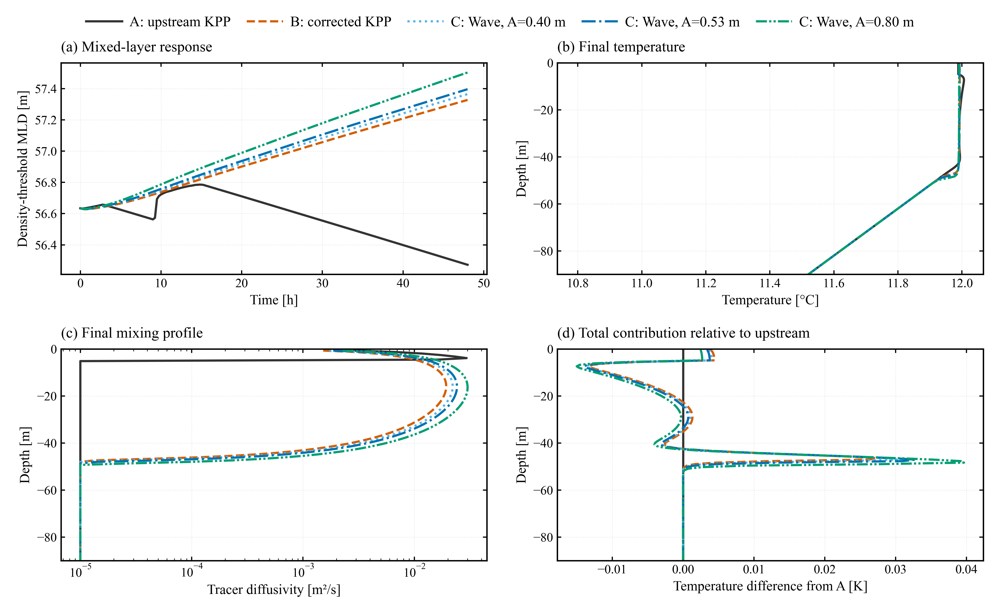
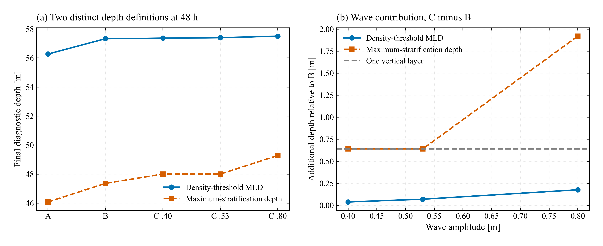
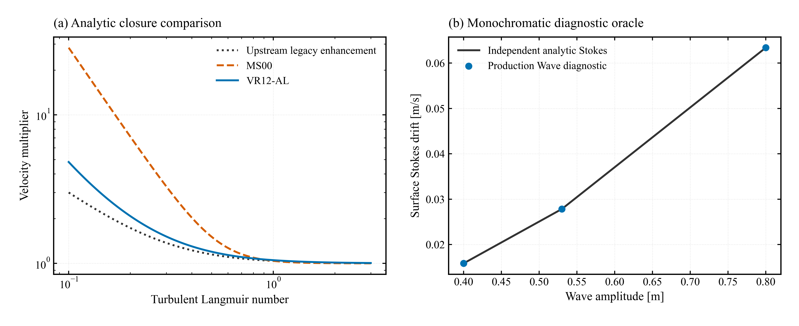

# Wave / upstream KPP controlled comparison

The Wave contribution extends the existing upstream KPP. This experiment
separates the original upstream model, a shared numerical correction and
the explicit wave-dependent VR12-AL feedback. All five columns completed
48 hours. The strict preregistered heat-budget gate failed in all five;
the failure is retained in machine-readable outputs, plots and exit status.

## Physical basis and implementation

- Van Roekel et al. (2012), *The form and orientation of Langmuir cells for
  misaligned winds and waves*, JGR 117, C05001,
  [doi:10.1029/2011JC007516](https://doi.org/10.1029/2011JC007516).
- Li et al. (2016), *Langmuir mixing effects on global climate: WAVEWATCH III
  in CESM*, Ocean Modelling 103, 145–160,
  [doi:10.1016/j.ocemod.2015.07.020](https://doi.org/10.1016/j.ocemod.2015.07.020),
  Table 2 / Eq. (12), aligned variant VR12-AL:
  `E = sqrt(1 + (3.1 La_t)^-2 + (5.4 La_t)^-4)` with
  `La_t = sqrt(u_star / |u_s(0)|)`. Coefficients are the published LES fit.
- Li & Fox-Kemper (2017), *Assessing the Effects of Langmuir Turbulence on
  the Entrainment Buoyancy Flux in the Ocean Surface Boundary Layer*, JPO
  47, 2863–2886,
  [doi:10.1175/JPO-D-17-0085.1](https://doi.org/10.1175/JPO-D-17-0085.1),
  Table 1 S-L2 / Eq. (4): the published monochromatic-wave conditions.

The same enhancement reaches tracer/momentum diffusivity velocity scales
and the scalar velocity in unresolved shear for the bulk-Richardson depth.
The existing non-local `K gamma` cancellation is preserved, with no second
enhancement multiplier. The reduced KPP shape function and smooth depth
selector remain existing model approximations. No VR12-EN extra Stokes-square
entrainment term, directional projection or new Coriolis-Stokes force is added.

The shared numerical correction evaluates `zeta = kappa B_f d / u_star^3`
directly. It avoids division by buoyancy flux and removes the dimensional
epsilon floor that changed weak imposed forcing. It also affects no-wave
KPP and is therefore evaluated separately, rather than attributed to Wave.

## Controls and reproducibility

| Arm | Source and physics | Purpose |
|---|---|---|
| A | Unmodified upstream KPP; Langmuir off | Original legoESM baseline |
| B | Weak-buoyancy correction; Langmuir off | Isolate numerical correction |
| C | B plus Wave surface-Stokes diagnostic and VR12-AL | Isolate wave feedback |

A uses upstream `890e837200b2b3534c3c18537cd1ccd56b2737f9`; its KPP blob is
verified separately. Workers check every imported legoESM source against the
chosen Git tree. B/C numerical implementation and instrument are committed
at `1332f62e4a`; individual JSON files retain full versions and import manifests.
The separate postprocessor revision and hashes of all 15 raw case artifacts
are in [summary.json](evidence/kpp_s_l2_20261119/summary.json).

The committed [preregistration](../../scripts/validate/wave_kpp_s_l2/PREREG.md)
and [configuration](../../scripts/validate/wave_kpp_s_l2/config.json) specify
the complete protocol. Initial profile data come from the pinned author
repository version, with source identifiers and SHA256 stamps. All arms use
the same linear EOS, canonical model constants, initial profiles, 256 cells
over 163.84 m, 60-s steps, weak wind stress 0.036 Pa, cooling 5 W/m² and
Coriolis parameter 1.028e-4 s^-1. No background diffusion is added twice.

The column uses a prescribed homogeneous monochromatic sea, k=0.1 m^-1,
with A=0.40/0.53/0.80 m; its variance A²/2 is placed exactly on a spectral
quadrature bin. The production Wave diagnostic matches an independent
finite-depth analytic Stokes expression within the preregistered 1e-12
relative tolerance. The scientific column does not advance a neural wave
forecast; real Wave advancement, remapping, one-step lag and continuation
are covered by separate short driver integration tests.

## Results and attribution



| Arm / wave amplitude | Final density-threshold MLD (m) | Final max-N² depth (m) |
|---|---:|---:|
| A / none | 56.27248 | 46.08 |
| B / none | 57.32798 | 47.36 |
| C / 0.40 m | 57.36524 | 48.00 |
| C / 0.53 m | 57.39647 | 48.00 |
| C / 0.80 m | 57.50330 | 49.28 |

The total A→C density-MLD change is +1.093 to +1.231 m. The numerical
correction A→B accounts for +1.056 m. The wave-only C−B change is
+0.037 / +0.068 / +0.175 m, below one 0.64-m layer. Sub-grid interpolation
allows these numerical values, but no grid-convergence evidence establishes
them as robust physical skill improvements.

The maximum-stratification depth is a separate descriptor used by LF17.
Its C−B shift is +0.64 / +0.64 / +1.92 m. The initial lower column has nearly
constant N², so the stored initial argmax is arbitrary at roundoff and is
not interpreted as an initial boundary-layer location. Only the final,
formed stratification peak is used in the comparison below.



Final peak diffusivity increases by 14.29% / 24.95% / 55.58% relative to B.
The maximum absolute final temperature difference from B is 0.01010 /
0.01864 / 0.03498 K. These are descriptive post-hoc summaries of the
preregistered profile quantities, not additional acceptance gates.

The wave-amplitude-dependent enhancement and stratification response agree
in direction with the literature. Exact LES profile agreement and global
MLD skill have not been measured. The density-threshold MLD here uses
0.03 kg/m³ from 10 m; it must not be equated to LF17's max-N² boundary depth.
The coupled diagnostic uses the physical surface value, while LF17 defines
its effective surface Stokes at the first cell centre, z=-0.32 m; both
analytic values are recorded. Canonical constants and the author-provided
rounded initial profile are also retained differences from the LES setup.



## Gates, reviews and remaining limits

- Formula, zero-wave limit, unresolved-shear forwarding, SCM Stokes/EOS
  forwarding, compiled spectrum→Stokes→SCM→KPP gradient and finite-difference
  comparisons pass. The compiled/eager SCM step parity test passes.
- The combined KPP/LMD94/under-ice/OMIP CLI/parameter-spec/coefficient checks
  passed 675 tests; the real Wave/driver/continuation and coupled-CLI group
  passed 25. The final instrument/gate/gradient group passed six tests.
  Independent reviewers additionally exercised planted disconnections and
  the restored old buoyancy floor; those controls failed as intended.
- All five integrations have finite 193-sample histories and satisfy the
  specified salt and momentum checks (residuals of order 1e-15).
- **The strict heat gate remains FAIL.** Cooling-normalized residuals are
  3.80–4.08e-10 versus the fixed 1e-10 limit. No tolerance, coefficient or
  analysis window was changed. The comparison and plot-existing commands
  exit nonzero while preserving all outcomes.
- The operator responsible for the accumulated heat residual has not been
  isolated. No inferred numerical explanation waives the fixed gate.
- Two independent Codex reviewers reviewed physics and the instrument/data
  separately. Named external Claude/GLM cross-model review is pending; an
  attempted Claude CLI review was rejected by automatic approval because it
  would send the unpublished local diff to a third-party destination. No
  external review result is claimed.

The implementation and evidence are reviewable, but this record does not
certify that all preregistered acceptance gates passed. Keep this limitation
visible in any PR description.

## Regenerate figures from the committed evidence

```bash
MPLCONFIGDIR=/tmp/legoesm-wave-kpp-matplotlib .venv/bin/python \
  scripts/validate/wave_kpp_coupling.py --plot-existing \
  --output-dir docs/wave/evidence/kpp_s_l2_20261119
```

This regenerates figures/summary, stamps the postprocessor revision and returns
1 for the retained heat-gate failures. Full integration commands are in the
[port validation guide](waden_port_validation.md). Use a new output directory
for a new integration; existing numerical evidence is never overwritten.
